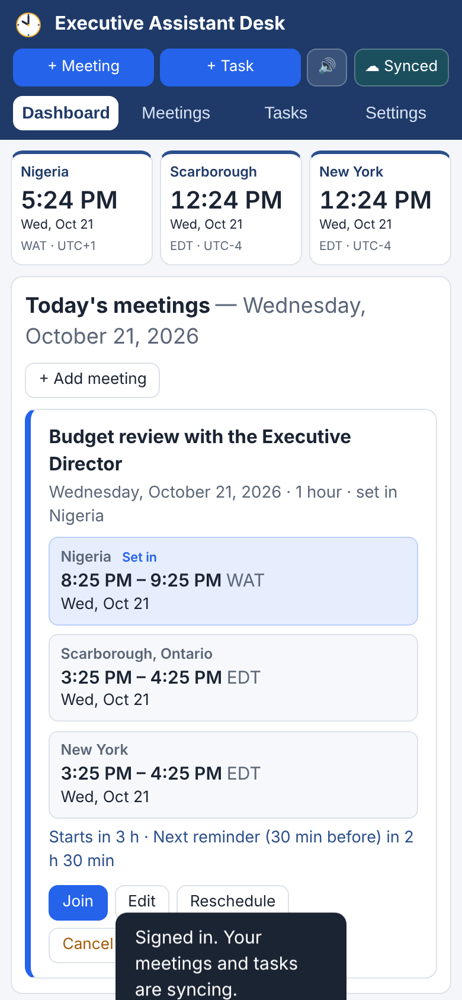
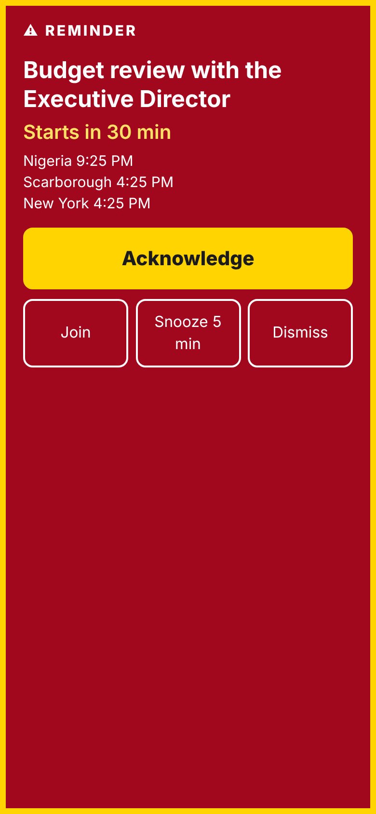
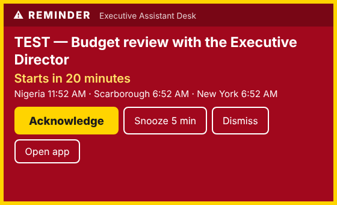

# Executive Assistant Desk

A Windows desktop app for managing an Executive Director's meetings and daily tasks:

- **Three live clocks** with dates: Nigeria (`Africa/Lagos`), Scarborough, Ontario (`America/Toronto`) and New York (`America/New_York`). Daylight saving time is handled automatically.
- **Meetings** with title, date, start time, duration, originating time zone, notes and an optional meeting link. Every meeting shows its time in all three places, and a **Next day / Previous day** badge when the date is different.
- **Spoken reminders** 30, 20, 10 and 5 minutes before each meeting, plus a Windows notification:
  *"Reminder: Budget review with the Executive Director starts in 20 minutes."*
- **Daily tasks** with due date, optional due time, priority, notes, a completion checkbox, Reopen, and optional spoken reminders.
- **Attention mode** (optional) for reminders that must not be missed: a loud alarm, then the spoken reminder, a flashing alert on top of all windows, repeated until you press **Acknowledge**. Optional vibration on an external device (game controller, or phone/smartwatch via push).
- **Android app + sync**: sign in with the same email on the PC and the phone. Each device keeps its own full copy and works offline, even when the other is switched off. Changes sync automatically whenever a device is online.
- Runs in the **system tray** when the window is closed, and can **start automatically** when you sign in to Windows.
- All data is saved on this computer only.


---

## Install on Windows

1. Get the installer, **`Executive-Assistant-Desk-Setup-1.2.0.exe`**:
   - from the **Actions** tab of this repository → the latest *Executive Assistant Desk (Windows build)* run → **Artifacts** → `Executive-Assistant-Desk-Setup` (it downloads as a .zip; extract it), **or**
   - build it yourself (see *Build the installer* below).
2. Double-click the installer.
3. **Windows SmartScreen** will probably say *"Windows protected your PC"* because the installer is not code-signed. Click **More info → Run anyway**. (This is expected for apps that haven't bought a code-signing certificate.)
4. Choose the install folder (the default is fine). The installer creates Start-menu and desktop shortcuts and opens the app.
5. In the app, open **Settings**:
   - Tick **Start automatically when I sign in to Windows**.
   - Pick a **Voice**, set the **Volume**, and click **Test voice**. You should hear the sample reminder.
6. Allow notifications: open **Windows Settings → System → Notifications**, make sure notifications are on and **Executive Assistant Desk** is allowed. If **Do not disturb** / **Focus** is on, desktop notifications are hidden (spoken reminders still play).
7. Optional: keep the tray icon visible. Click the **^** arrow at the right end of the taskbar and drag the clock icon onto the taskbar, or turn it on in **Settings → Personalization → Taskbar → Other system tray icons**.

**To exit completely**, right-click the tray icon and choose **Quit**. Closing the window only hides it so reminders keep working.

**To uninstall**, use **Settings → Apps → Installed apps → Executive Assistant Desk → Uninstall**. Your saved data is kept in `%APPDATA%\Executive Assistant Desk\` (delete that folder if you want to remove it too).

### If you don't hear anything

- Check that the 🔊 button in the top bar says **Voice on** (not *Muted*), and the Windows volume is up.
- In **Settings → Speech engine**, switch to **Windows speech (PowerShell)** and click **Test voice**. This uses the Windows speech engine directly and is the fallback if the built-in voice list is empty.
- More voices can be added in **Windows Settings → Time & language → Speech → Add voices**.

---

## Android app and sync

 

### How it works

```
  Windows PC  ──┐                        ┌──  Android phone
  (full copy,   │   Firebase (Google's   │   (full copy,
   works        ├── free cloud service): ├──  works
   offline)     │   email sign-in +      │    offline)
                └── your synced data  ───┘
```

- **Each device has all your meetings and tasks**, so either one works on its own: offline, or while the other one is switched off.
- When a device is online, it uploads its changes within a couple of seconds and checks for changes from the other device every minute. It also checks right away when the app opens or the PC wakes up. While an alert is waiting for Acknowledge, it checks every 15 seconds.
- **If the same item was changed on both devices** while they were apart, the most recent change wins.
- Deletions, completed tasks, reschedules, cancellations, and **Acknowledge / Dismiss** all sync. Acknowledge an alarm on the phone and the PC stops ringing too.
- Settings (voice, volume, attention-mode choices) are kept per device.
- Your data is stored under your own account, and the security rules only let that account read or change it. On the PC, the sign-in is saved encrypted with Windows' own protection.

### Set up sync (one time, about 10 minutes)

Sync uses a free Firebase project that belongs to you. This is the always-on service in the middle, which is what lets the phone work while the PC is off.

1. Go to <https://console.firebase.google.com>, sign in with a Google account, and click **Create a project**. Name it, e.g. `executive-assistant-desk`. Google Analytics is not needed.
2. **Build → Authentication → Get started → Sign-in method → Email/Password → Enable → Save.**
3. **Build → Firestore Database → Create database.** Pick a location near you and choose *production mode*.
4. In Firestore, open the **Rules** tab. Replace the text with the contents of [`firebase/firestore.rules`](firebase/firestore.rules) and click **Publish**. This is what keeps your data private to your account.
5. Click the **gear icon → Project settings**. Note the **Project ID**. Under *Your apps*, click the **Web** icon `</>`, register an app (any name, no hosting), and copy the **apiKey** value (it starts with `AIza`).
6. Give the two values to the apps, in one of these ways:
   - **Easiest:** in GitHub, open **Settings → Secrets and variables → Actions** and add two repository secrets, `FIREBASE_PROJECT_ID` and `FIREBASE_API_KEY`. The next automatic build bakes them into both the Windows installer and the Android app, so you only ever type your email and password.
   - Or put them in `src/shared/sync-config.json` and rebuild.
   - Or paste them into **Settings → Account & sync** on each device.

   The API key only identifies your project; it is not a password. Your data is protected by your account and the rules from step 4.
7. On the PC: **Settings → Account & sync → enter your email and a password → Create account.** On the phone: same email and password → **Sign in**.

The free plan covers this many times over: two devices use roughly 3,000 of the 50,000 free reads a day.

Forgot the password? Enter your email and press **Forgot password?**. Firebase emails you a reset link.

### Install the Android app

1. Get **`Executive-Assistant-Desk.apk`**: GitHub → **Actions** → latest *Executive Assistant Desk* run → **Artifacts** → `Executive-Assistant-Desk-Android` (a .zip; extract the .apk).
2. Copy it to the phone (e.g. email it to yourself, Google Drive, or a USB cable) and tap it.
3. Android asks to **allow installing unknown apps** from that app (Files / Chrome / Drive). Allow it, then **Install**. If Play Protect warns about an unknown developer, choose **Install anyway**. This happens because the app is not from the Play Store.
4. Open the app and **allow notifications**.
5. In the app: **Settings → Phone**. If it shows *Exact timing is off*, tap **Allow exact timing**. Also set Android **Settings → Apps → Executive Assistant Desk → Battery → Unrestricted**. Without this, some phones (Samsung, Xiaomi, Huawei…) delay or block reminders.
6. **Settings → Account & sync → Sign in** with the same email and password as on the PC.

**Updating the Android app:** these builds are not signed with a fixed key, so a new version won't install over the old one. Check that the app says **☁ Synced**, uninstall the old app, install the new one, and sign in: everything comes back from your account. To get normal in-place updates, create a signing key once and add it as GitHub secrets:

```bash
keytool -genkeypair -v -keystore ead.keystore -alias ead -keyalg RSA -keysize 2048 -validity 10000
base64 -w0 ead.keystore   # → secret ANDROID_KEYSTORE_BASE64
```

Also add `ANDROID_KEYSTORE_PASSWORD`, `ANDROID_KEY_ALIAS` (`ead`) and `ANDROID_KEY_PASSWORD`. Keep the keystore file safe and out of the repository.

### What the phone does

- **Reminders arrive even when the app is closed or the phone is locked.** Every upcoming 30/20/10/5-minute reminder (and spoken-task reminder) is scheduled with Android in advance, for the next 14 days.
- **Notification buttons**: Acknowledge, Snooze, Dismiss.
- **Spoken reminders** use the phone's voice while the app is open. When it is closed, you get the notification sound and vibration.
- **Attention mode** on the phone:
  - While the app is open: the alarm, the voice, a full-screen flashing alert, and vibration.
  - While it is closed: an "Attention alerts (alarm)" notification with an alarm sound, repeated (up to 12 times) until you acknowledge.
  - You can change that alarm sound in Android's notification settings for the app.
- **Reminders Android already showed** while the app was closed are not reported as "missed" when you reopen it. The latest one is shown so you can Snooze, Dismiss or Join.

### Limits to know

- The phone syncs while the app is open (when you open it, then every minute). Android doesn't let it sync while fully closed.
  - A meeting added on the PC reaches the phone, and gets its phone reminders, the next time you open the phone app. Open it once after planning your day on the PC.
  - The PC is always on while it runs, so it gets phone changes within a minute.
  - If you Acknowledge on the PC while the phone app is closed, the phone's already-scheduled repeat alarms still ring. Acknowledge them there too.
- Only one account per device.

---

## Attention mode

Turn it on in **Settings → Attention mode**, then press **Test attention alert** to try the full sequence. The test repeats every 20 seconds, up to 3 times, until you press Acknowledge.



When a reminder uses attention mode:

1. A **loud alarm** plays (Siren, Rapid beeps or Bell; volume and length adjustable; **Test alarm sound** button).
2. The reminder is **spoken** right after the alarm.
3. A **flashing red/yellow alert** appears at the top of the screen, above all other windows. The taskbar button flashes, the dashboard banner flashes, and the Windows notification stays on screen until clicked.
   - The alert appears without taking the keyboard, so typing in another program can't acknowledge it by accident.
   - It flashes once per second, well below the 3-flashes-per-second safety limit. Untick **Flashing alert** for a steady red alert instead.
4. Steps 1–3 **repeat** every 30 s / 1 / 2 / 3 / 5 minutes (your choice) until you press **Acknowledge** (or **Snooze**, **Dismiss** or **Join meeting**). Closing the alert window also counts as acknowledging it.

Notes:
- You choose which reminders use it (any of 30 / 20 / 10 / 5 minutes, and optionally spoken task reminders). The others stay as normal spoken reminders.
- Acknowledging stops the alarm for that reminder only. The next scheduled reminder (e.g. 20 minutes) still sounds, and the banner stays for Snooze / Dismiss / Join.
- Repeats stop by themselves when the meeting ends (task alerts: one hour after the due time). After sleep or a restart, an unacknowledged alert is not replayed.
- **Mute** silences the alarm and voice, but the flashing alert still appears.
- How loud the alarm is also depends on the Windows volume and your speakers.

### Optional external vibration

The app does **not** assume your computer can vibrate (Windows PCs normally can't). If none of these options is set up, nothing is attempted. You can use either or both:

**A. A game controller** (Xbox One / Series or another XInput-compatible controller, USB or Bluetooth)
1. Connect the controller to the PC and **press any button on it once**. Windows only shows a controller to apps after it has been used.
2. In Settings, tick **Vibrate a game controller** and click **Test controller**.
3. Keep the controller where you'll feel it (in your lap or on the desk). It buzzes 3 times with each attention alert.

**B. Your phone or smartwatch, using an urgent push notification**
1. Install the free **ntfy** app on your phone (Android or iPhone). In the app, subscribe to a topic with a long, hard-to-guess name, e.g. `ead-alerts-7Fq29xKp`. Set the topic's notifications to vibrate. A paired smartwatch will vibrate too if it mirrors phone notifications.
2. In Settings choose **ntfy app**, enter `https://ntfy.sh/ead-alerts-7Fq29xKp` (your topic name), tick **Send an urgent push**, and click **Test push**.
3. Privacy: the meeting title is sent to the service. Anyone who knows a topic name on the public ntfy.sh server can read it, so keep the name secret, or run your own ntfy server.

**Other services/devices:** choose **Other service (JSON web request)**. The app POSTs JSON to your address on each alert:

```json
{ "app": "Executive Assistant Desk", "event": "reminder", "kind": "meeting",
  "title": "Board chair call", "message": "Reminder: Board chair call starts in 30 minutes.",
  "startsAt": "2026-10-21T11:18:00.000Z", "vibrate": true }
```

Repeats are sent with `"event": "reminder-repeat"`. You can point this at Home Assistant, Pushover, IFTTT, Zapier, a vibrating pager or wristband with a web hook, or your own device.

---

## How to use

| Action | How |
| --- | --- |
| Add a meeting | **+ Add meeting** (top bar, dashboard, or tray menu). Choose the time zone the meeting was set in; the dialog previews the time in all three places before you save. |
| Edit / reschedule | **Edit** or **Reschedule** on a meeting card. Reminders are recalculated immediately. |
| Cancel | **Cancel meeting**; reminders stop. **Restore** brings it back (only future reminders play). Past and cancelled meetings can be deleted. |
| Join | **Join** opens the meeting link in your browser. |
| Snooze / dismiss | When a reminder plays, a yellow banner appears at the top: **Snooze** (length set in Settings) or **Dismiss** (no further reminders for that meeting). Clicking the Windows notification opens the app on that banner. |
| Mute | 🔊 button in the top bar, the tray menu, or Settings. Notifications still appear while muted. |
| Acknowledge | In attention mode, the big yellow **Acknowledge** button on the flashing alert (or the red one on the dashboard banner) stops the alarm repeating. |
| Tasks | **+ Add task**. Tick the checkbox to complete; untick or press **Reopen** to reopen. Tick *Speak a reminder* (needs a due time) for a spoken task reminder. |

**Dashboard:** clocks at the top; then any active or missed reminders; then *Today's meetings* (and the next few coming up) on the left and the *Daily checklist* on the right (overdue tasks, tasks due today, and tasks completed today). Unfinished tasks stay in **Overdue** until they are completed.

### How reminders behave

- Each reminder is spoken **once**. Every reminder has a fixed identity (meeting + start time + 30/20/10/5); once it has played it is recorded on disk, so restarts or repeated checks never repeat it.
- If several meetings are due at the same moment, the announcements are **queued** and spoken one after another (earliest meeting first), never on top of each other.
- If you add a meeting less than 30 minutes ahead, only the reminders still in the future are used.
- **After sleep, shutdown or restart:** reminders whose time passed while the computer was off are **not spoken**. They are listed as *Missed while away* on the dashboard, with one summary notification. Only a reminder that became due in the last 2 minutes is still spoken.
- The app checks every 5 seconds and again as soon as Windows wakes or unlocks, so reminders play within a few seconds of the right time.
- Times that don't exist on a daylight-saving change day (e.g. 2:30 AM on the March change day in Toronto/New York) are moved forward and you're told; times that happen twice (the November change) use the first occurrence.

---

## Build the installer

On Windows (recommended), with [Node.js 22 LTS](https://nodejs.org) installed, open **PowerShell** in this folder:

```powershell
npm ci
npm test              # unit tests
npm run test:e2e      # drives the real app end to end
npm run dist:win      # creates dist\Executive-Assistant-Desk-Setup-1.2.0.exe
```

To run without installing: `npm start`.

On Linux the same `npm run dist:win` works if Wine is installed (`sudo apt install wine`). The GitHub Actions workflow `.github/workflows/executive-assistant-desk.yml` builds and tests on a Windows machine on every push and attaches the installer to the run.

**Optional code signing** (removes the SmartScreen warning): buy a code-signing certificate and set `CSC_LINK` (path to the .pfx) and `CSC_KEY_PASSWORD` before `npm run dist:win`.

---

## Verification

Also: `npm run test:sync` (9 tests against the Firebase emulators: real sign-in, database and security rules) and `npm run test:sync-e2e` (13 steps: the real desktop app and the phone app syncing with each other). Both need Java 21 for the emulators. The sync end-to-end test runs the phone app's screens in Chromium at phone size, standing in for the Android device.

| Sync | What is checked |
| --- | --- |
| Both directions | A meeting and task created on the PC appear on the phone; completion on the phone shows on the PC; deletions and reschedules travel. |
| Offline / PC off | With the PC closed and the phone offline, the phone keeps working and shows "Offline"; the change uploads when back online; the PC gets it when switched on again (still signed in). |
| Conflicts | Two offline edits to the same task: the most recent wins on both devices regardless of sync order. |
| Merge | Data already on both devices before signing in is combined. |
| Alerts | Acknowledge on the phone stops the PC's alarm; the phone cancels its own repeat notifications. |
| Phone reminders | 30/20/10/5-minute Android notifications scheduled; moved after a reschedule on the PC; attention repeats scheduled; reminders shown while the app was closed are not listed as missed. |
| Security | Another account cannot read your data; bad tokens are refused. |
| Accounts | Clear messages for wrong password / existing account / short password; token refresh; password reset email; sign-out keeps local data. |
| Scale | 650 tasks sync completely (paged downloads). |


`npm test` (40 unit tests, `test/`) and `npm run test:e2e` (the real app, `test/e2e/run-e2e.js`) check:

| Area | What is checked |
| --- | --- |
| Reminder timing | Reminders fire at 30/20/10/5 min, each within 5 s of its time; exact announcement text; no repeats on repeated checks; meetings added < 30 min ahead; overlapping meetings queued in start order; snooze replays with the real time left; a snooze landing on a scheduled reminder plays once; dismiss stops the rest; task reminders. |
| Time zones | Lagos UTC+1 all year; Toronto/New York EST↔EDT; Next day/Previous day marking (23:30 Toronto = 04:30 next day Lagos; 02:00 Lagos = 21:00 previous day Toronto). |
| Daylight saving | Lagos–Toronto gap goes 6 h → 5 h on 8 Mar 2026 and back on 1 Nov 2026; skipped time (02:30 on 8 Mar) moved to 03:30 with a warning; repeated time (01:30 on 1 Nov) uses the first occurrence; reminders around the change fire at the correct instants. |
| Saving after restart | Meetings, tasks, completion state, settings and reminder history survive a restart; a corrupted data file falls back to the automatic backup. |
| Sleep / restart | Expired reminders are listed as missed, never spoken; the next reminder still plays on time; an outdated on-screen reminder is cleared. |
| Completion tracking | Checkbox completes, Reopen reopens, completed timestamp recorded, overdue tasks stay visible until done, "x of y done today" progress. |
| Edits | Rescheduling recalculates reminders; title-only edits don't replay; cancel stops reminders; restore only uses future reminders. |
| Attention mode | The Test button plays the alarm, then the voice, shows the flashing on-top alert, sends the vibration push, and repeats every 20 s until acknowledged. Meeting alerts repeat on the chosen interval with updated wording ("starts in 29 minutes"). Acknowledge (from the alert or the dashboard) stops repeats and keeps the banner. Only the chosen reminder times use it. Repeats stop at the meeting end, after sleep, or when the mode is turned off. A new scheduled reminder replaces a repeating one, so you never get two alarms at once. Snooze and dismiss also stop it. Mute silences sound but still shows the alert. |

The end-to-end test moves the app's internal clock forward (a test-only switch, `EAD_TEST=1`) so it can show reminders firing without waiting 30 minutes.

## Where things live

```
src/main/main.js        window, tray, notifications, auto-start, IPC, 5-second reminder loop
src/main/scheduler.js   reminder engine (dedupe, missed-after-sleep, snooze, dismiss, queue order)
src/main/model.js       meeting/task validation and saving
src/main/store.js       local JSON storage (%APPDATA%\Executive Assistant Desk\data.json, with .bak)
src/shared/tz.js        time-zone conversion and DST handling (built-in Intl/ICU data)
src/shared/tasks.js     overdue / today / upcoming / completed
src/renderer/           the interface (HTML/CSS/JS) and the speech queue
src/renderer/alarm.js   alarm tones (Web Audio, no sound files)
src/renderer/attention.* the flashing always-on-top alert window
src/renderer/vibrate.js game-controller vibration (Gamepad API)
src/shared/sync.js      cloud sync (Firebase sign-in + Firestore over HTTPS; shared by PC and phone)
src/shared/data.js      data layout and settings rules (shared by PC and phone)
firebase/               Firestore security rules and emulator config (for tests)
mobile/                 Android app (Capacitor): src/mobile.js is the phone engine, android/ the native project
```
