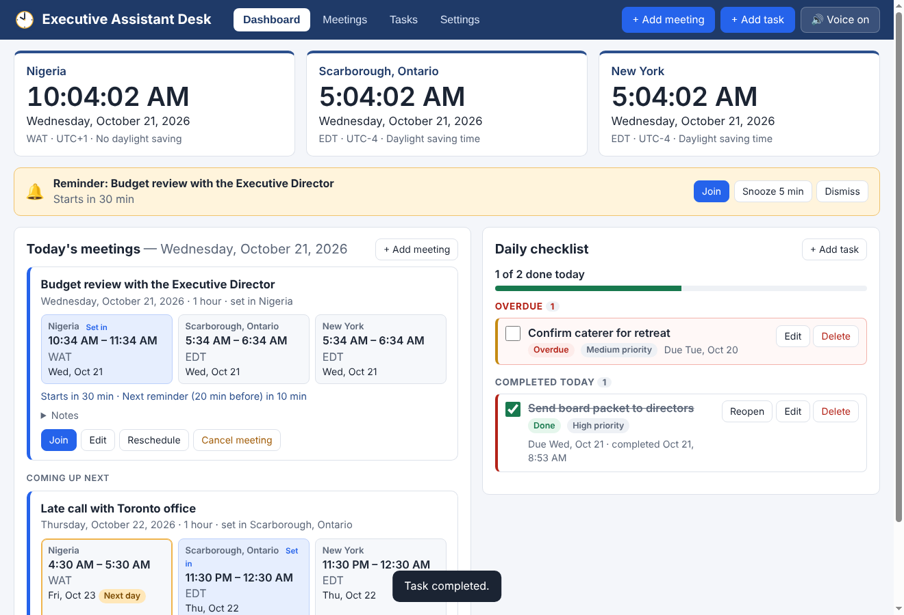

# Executive Assistant Desk

A Windows desktop app for managing an Executive Director's meetings and daily tasks:

- **Three live clocks** with dates: Nigeria (`Africa/Lagos`), Scarborough, Ontario (`America/Toronto`) and New York (`America/New_York`). Daylight saving time is handled automatically.
- **Meetings** with title, date, start time, duration, originating time zone, notes and an optional meeting link. Every meeting shows its time in all three places, and a **Next day / Previous day** badge when the date is different.
- **Spoken reminders** 30, 20, 10 and 5 minutes before each meeting, plus a Windows notification:
  *"Reminder: Budget review with the Executive Director starts in 20 minutes."*
- **Daily tasks** with due date, optional due time, priority, notes, a completion checkbox, Reopen, and optional spoken reminders.
- Runs in the **system tray** when the window is closed, and can **start automatically** when you sign in to Windows.
- All data is saved on this computer only.



---

## Install on Windows

1. Get the installer, **`Executive-Assistant-Desk-Setup-1.0.0.exe`**:
   - from the **Actions** tab of this repository → the latest *Executive Assistant Desk (Windows build)* run → **Artifacts** → `Executive-Assistant-Desk-Setup` (it downloads as a .zip; extract it), **or**
   - build it yourself (see *Build the installer* below).
2. Double-click the installer.
3. **Windows SmartScreen** will probably say *"Windows protected your PC"* because the installer is not code-signed. Click **More info → Run anyway**. (This is expected for apps that haven't bought a code-signing certificate.)
4. Choose the install folder (the default is fine). The installer creates Start-menu and desktop shortcuts and opens the app.
5. In the app, open **Settings**:
   - Tick **Start automatically when I sign in to Windows**.
   - Pick a **Voice**, set the **Volume**, and click **Test voice**. You should hear the sample reminder.
6. Allow notifications: open **Windows Settings → System → Notifications**, make sure notifications are on and **Executive Assistant Desk** is allowed. If **Do not disturb** / **Focus** is on, desktop notifications are hidden (spoken reminders still play).
7. Optional: keep the tray icon visible. Click the **^** arrow at the right end of the taskbar and drag the clock icon onto the taskbar, or turn it on in **Settings → Personalization → Taskbar → Other system tray icons**.

**To exit completely**, right-click the tray icon and choose **Quit**. Closing the window only hides it so reminders keep working.

**To uninstall**, use **Settings → Apps → Installed apps → Executive Assistant Desk → Uninstall**. Your saved data is kept in `%APPDATA%\Executive Assistant Desk\` (delete that folder if you want to remove it too).

### If you don't hear anything

- Check that the 🔊 button in the top bar says **Voice on** (not *Muted*), and the Windows volume is up.
- In **Settings → Speech engine**, switch to **Windows speech (PowerShell)** and click **Test voice**. This uses the Windows speech engine directly and is the fallback if the built-in voice list is empty.
- More voices can be added in **Windows Settings → Time & language → Speech → Add voices**.

---

## How to use

| Action | How |
| --- | --- |
| Add a meeting | **+ Add meeting** (top bar, dashboard, or tray menu). Choose the time zone the meeting was set in; the dialog previews the time in all three places before you save. |
| Edit / reschedule | **Edit** or **Reschedule** on a meeting card. Reminders are recalculated immediately. |
| Cancel | **Cancel meeting**; reminders stop. **Restore** brings it back (only future reminders play). Past and cancelled meetings can be deleted. |
| Join | **Join** opens the meeting link in your browser. |
| Snooze / dismiss | When a reminder plays, a yellow banner appears at the top: **Snooze** (length set in Settings) or **Dismiss** (no further reminders for that meeting). Clicking the Windows notification opens the app on that banner. |
| Mute | 🔊 button in the top bar, the tray menu, or Settings. Notifications still appear while muted. |
| Tasks | **+ Add task**. Tick the checkbox to complete; untick or press **Reopen** to reopen. Tick *Speak a reminder* (needs a due time) for a spoken task reminder. |

**Dashboard:** clocks at the top; then any active or missed reminders; then *Today's meetings* (and the next few coming up) on the left and the *Daily checklist* on the right (overdue tasks, tasks due today, and tasks completed today). Unfinished tasks stay in **Overdue** until they are completed.

### How reminders behave

- Each reminder is spoken **once**. Every reminder has a fixed identity (meeting + start time + 30/20/10/5); once it has played it is recorded on disk, so restarts or repeated checks never repeat it.
- If several meetings are due at the same moment, the announcements are **queued** and spoken one after another (earliest meeting first), never on top of each other.
- If you add a meeting less than 30 minutes ahead, only the reminders still in the future are used.
- **After sleep, shutdown or restart:** reminders whose time passed while the computer was off are **not spoken**. They are listed as *Missed while away* on the dashboard, with one summary notification. Only a reminder that became due in the last 2 minutes is still spoken.
- The app checks every 5 seconds and again as soon as Windows wakes or unlocks, so reminders play within a few seconds of the right time.
- Times that don't exist on a daylight-saving change day (e.g. 2:30 AM on the March change day in Toronto/New York) are moved forward and you're told; times that happen twice (the November change) use the first occurrence.

---

## Build the installer

On Windows (recommended), with [Node.js 22 LTS](https://nodejs.org) installed, open **PowerShell** in this folder:

```powershell
npm ci
npm test              # unit tests
npm run test:e2e      # drives the real app end to end
npm run dist:win      # creates dist\Executive-Assistant-Desk-Setup-1.0.0.exe
```

To run without installing: `npm start`.

On Linux the same `npm run dist:win` works if Wine is installed (`sudo apt install wine`). The GitHub Actions workflow `.github/workflows/executive-assistant-desk.yml` builds and tests on a Windows machine on every push and attaches the installer to the run.

**Optional code signing** (removes the SmartScreen warning): buy a code-signing certificate and set `CSC_LINK` (path to the .pfx) and `CSC_KEY_PASSWORD` before `npm run dist:win`.

---

## Verification

`npm test` (30 unit tests, `test/`) and `npm run test:e2e` (the real app, `test/e2e/run-e2e.js`) check:

| Area | What is checked |
| --- | --- |
| Reminder timing | Reminders fire at 30/20/10/5 min, each within 5 s of its time; exact announcement text; no repeats on repeated checks; meetings added < 30 min ahead; overlapping meetings queued in start order; snooze replays with the real time left; a snooze landing on a scheduled reminder plays once; dismiss stops the rest; task reminders. |
| Time zones | Lagos UTC+1 all year; Toronto/New York EST↔EDT; Next day/Previous day marking (23:30 Toronto = 04:30 next day Lagos; 02:00 Lagos = 21:00 previous day Toronto). |
| Daylight saving | Lagos–Toronto gap goes 6 h → 5 h on 8 Mar 2026 and back on 1 Nov 2026; skipped time (02:30 on 8 Mar) moved to 03:30 with a warning; repeated time (01:30 on 1 Nov) uses the first occurrence; reminders around the change fire at the correct instants. |
| Saving after restart | Meetings, tasks, completion state, settings and reminder history survive a restart; a corrupted data file falls back to the automatic backup. |
| Sleep / restart | Expired reminders are listed as missed, never spoken; the next reminder still plays on time; an outdated on-screen reminder is cleared. |
| Completion tracking | Checkbox completes, Reopen reopens, completed timestamp recorded, overdue tasks stay visible until done, "x of y done today" progress. |
| Edits | Rescheduling recalculates reminders; title-only edits don't replay; cancel stops reminders; restore only uses future reminders. |

The end-to-end test moves the app's internal clock forward (a test-only switch, `EAD_TEST=1`) so it can show reminders firing without waiting 30 minutes.

## Where things live

```
src/main/main.js        window, tray, notifications, auto-start, IPC, 5-second reminder loop
src/main/scheduler.js   reminder engine (dedupe, missed-after-sleep, snooze, dismiss, queue order)
src/main/model.js       meeting/task validation and saving
src/main/store.js       local JSON storage (%APPDATA%\Executive Assistant Desk\data.json, with .bak)
src/shared/tz.js        time-zone conversion and DST handling (built-in Intl/ICU data)
src/shared/tasks.js     overdue / today / upcoming / completed
src/renderer/           the interface (HTML/CSS/JS) and the speech queue
```
