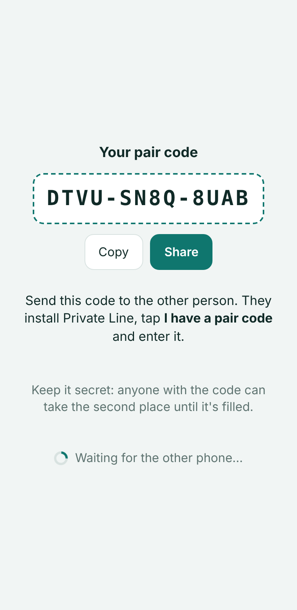
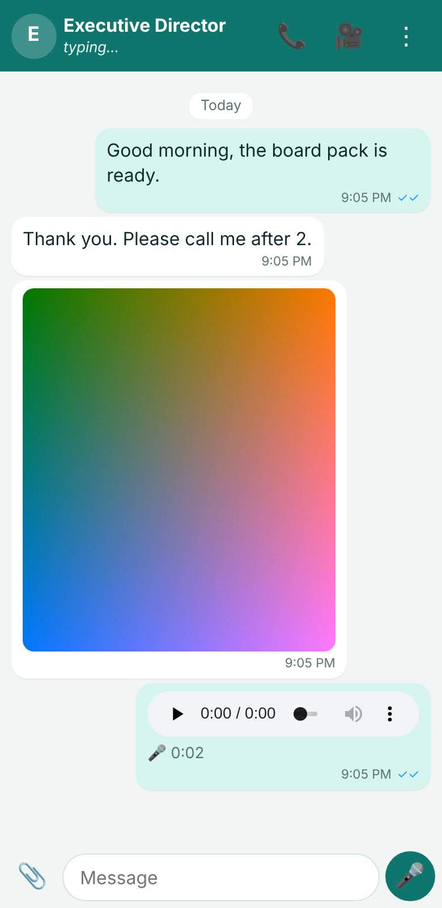
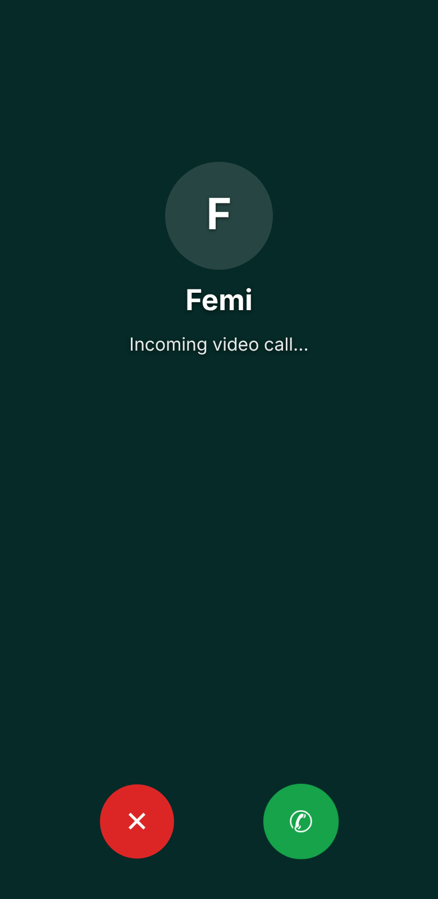
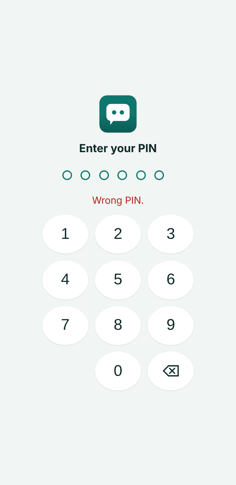

# Private Line

An Android app for private communication between **exactly two people**: text messages, photos, voice messages, files, voice calls and video calls.

- **Activated with a secret pair code.** One person creates the line and gets a code like `K7QX-M2PD-9WTR`; the other person enters it. Once both phones are activated, the code can't add a third phone.
- **Protected by a PIN** (and optionally fingerprint / face) every time the app opens.
- **Moving to a new phone:** enter the pair code + your PIN; the old phone is cut off automatically.

   

## What it does

| | |
| --- | --- |
| Messages | Real-time text with ✓ sent, ✓✓ delivered, blue ✓✓ read; "typing…" and "online / last seen"; reply to a message; delete for everyone. Works offline: messages wait (🕓) and send by themselves when the connection returns. Full history is kept on the phone. |
| Photos, voice, files | Photos are shrunk before sending (saves data). Tap 🎤 to record a voice message, ➤ to send. Files up to 25 MB. |
| Calls | Voice and video calls, phone to phone. Mute, camera on/off, switch front/back camera. Calls show in the chat history ("Video call · 3:24", "Missed voice call", "declined"). |
| When the app is closed | New messages arrive as notifications. An incoming call **rings for up to 30 seconds** with a ringtone; tap the notification to answer. |
| Privacy | Only the two activated phones can read or write anything: enforced by the server's security rules, not just the app. The pair code and PIN are never stored on the server (only slow, one-way hashes). Photos and voice messages are only downloadable by the two phones. |
| Lock | 6-digit PIN (weak ones like 111111 refused); fingerprint/face optional; locks after 0 / 1 / 5 / 30 minutes in the background; after 5 wrong PINs it waits before allowing more tries. |

## How it works

```
 Phone A ──┐     Your Firebase project (Google)     ┌── Phone B
 (app)     ├──►  database: messages, call set-up  ◄─┤   (app)
           │     storage: photos, voice notes       │
           │     functions: send the notifications  │
           └────── calls go phone ↔ phone directly ─┘
```

The app uses **your own Firebase project**. Nothing runs on anyone else's server, and you control the data.

## Set up (one time, about 20 minutes)

You can reuse the Firebase project you created for Executive Assistant Desk, or create a new one at <https://console.firebase.google.com>.

1. **Upgrade to the Blaze (pay-as-you-go) plan.** In the console click **Upgrade**. It's needed for the notification functions and for storing photos.
   - Two people stay inside the free allowance, so the expected cost is **$0** (at most a few cents a month).
   - Set a budget alert of $1 when asked.
2. **Authentication → Get started → Sign-in method → Anonymous → Enable.** The pair code is the "account"; nobody types an email.
3. **Firestore Database → Create database** (production mode). Skip this if it already exists.
4. **Storage → Get started.**
5. **Project settings (gear) → Your apps → Add app → Web `</>`.** Give it any name, then copy the whole `firebaseConfig = { … }` snippet.
6. **Add app → Android.** Package name: `com.privateline.app`. Download **google-services.json**.
7. **Project settings → Service accounts → Generate new private key.** A `.json` file downloads. Keep it private: it lets GitHub upload the server part.
8. In GitHub, open **Settings → Secrets and variables → Actions → New repository secret** and add:

   | Secret | Value |
   | --- | --- |
   | `PL_FIREBASE_WEB_CONFIG` | the snippet from step 5 |
   | `PL_GOOGLE_SERVICES_JSON` | the whole contents of google-services.json (step 6) |
   | `PL_FIREBASE_SERVICE_ACCOUNT` | the whole contents of the key file (step 7) |
   | `PL_FIREBASE_PROJECT_ID` | your project ID (shown in Project settings) |

9. In GitHub, open **Actions → Private Line (Android app) → Run workflow**, tick **Also upload the server part**, then click **Run workflow**.
   - This builds the app and uploads the security rules and notification functions to your project.
   - When it finishes, download **Private-Line-Android** from the run's *Artifacts* (a .zip with `Private-Line.apk` inside).

## Install and activate

1. Copy `Private-Line.apk` to each phone and tap it.
   - Allow **Install unknown apps** for the app you opened it from.
   - If Play Protect warns about an unknown developer, choose **Install anyway**. This is because the app is not from the Play Store.
2. **First person:**
   - **Create a new private line** → your name → choose a PIN (twice).
   - The pair code appears. Tap **Share** and send it to the other person. Sending it by phone call or in person is safest.
3. **Second person:** **I have a pair code** → enter the code and their name → when asked, choose **Cancel** ("I am the second person") → choose a PIN.
4. Allow **notifications**, **microphone** and **camera** when asked.
5. On each phone, set Android **Settings → Apps → Private Line → Battery → Unrestricted**, so messages and calls arrive promptly.

**Remember your PIN and keep the pair code** (Settings → Show pair code). You need both to move to a new phone.

### New phone
Install the app → **I have a pair code** → enter the code and your name → enter **your PIN**. All messages come back, and the old phone stops working with the line.

The person who created the line can also do this before the second person has joined: answer **OK** to "I am … and this is my new phone".

### Updating the app
Without a signing key (below), a new build won't install over the old one: uninstall, install the new APK, then use the **new phone** steps above. Your messages come back.

For normal in-place updates, create a key once and add the secrets `PL_ANDROID_KEYSTORE_BASE64`, `PL_ANDROID_KEYSTORE_PASSWORD`, `PL_ANDROID_KEY_ALIAS` and `PL_ANDROID_KEY_PASSWORD`. The steps are the same as in the Executive Assistant Desk README.

## Calls on every network (recommended)

Calls go directly between the phones. Some mobile networks block direct connections; on those, calls need a relay. Cloudflare provides one free (1,000 GB a month):

1. In the Cloudflare dashboard, open **Realtime → TURN Server → Create**, and copy the **Key ID** and **API token**.
2. Add the GitHub secrets `PL_TURN_KEY_ID` and `PL_TURN_KEY_TOKEN`, then run the workflow again with **Also upload the server part** ticked.

Without it, calls work on Wi-Fi and most networks, but some calls on mobile data may fail to connect ("Call failed — poor connection").

## Limits to know

- **Incoming calls while the app is closed** ring through a notification (ringtone for up to 30 seconds). Tap it to open the app and answer. It is not the full-screen caller screen a normal phone call shows over the lock screen; that needs deeper Android phone integration. If the phone is on Do Not Disturb, it won't ring.
- **No speaker / earpiece switch** in calls: Android picks the output (speaker, earpiece or headset).
- **Encryption:** messages are encrypted in transit and on Google's servers, and only the two phones are allowed to read them. They are **not end-to-end encrypted**: the owner of the Firebase project (you) could view them in the Firebase console.
- **Keep the pair code secret.** Until the second person joins, anyone with the code could take that place. Afterwards, the code alone is useless without a PIN.
- I tested everything with two simulated phones (see below), not on physical Android phones. The first real install is the final check for notifications, ringing, camera and microphone.

## For developers

```bash
npm ci && (cd functions && npm ci)
npm run build:www          # bundle the app into www/
npm run test:e2e           # Firebase emulators + 3 phone-sized Chromium "phones" (needs Java 21)
npm run build              # build + copy into the Android project
cd android && ./gradlew assembleDebug
```

`npm run test:e2e` (19 steps) runs on the Firebase emulators with the real security rules and functions. It covers:
- creating the line (weak and mismatched PINs refused);
- the code and PIN never being stored on the server;
- joining, with the code typed loosely;
- a third phone being refused, and a wrong PIN failing to take over a place;
- messages, read ticks, typing, photos and voice messages;
- push notifications going only to the other phone;
- delete for everyone, and sending offline;
- video calls with live video both ways, mute, hang-up and call history;
- declined calls;
- the PIN lock;
- moving to a new phone, with the old one cut off;
- unauthenticated reads being refused.

```
src/js/app.js        screens and flow          src/js/calls.js     WebRTC voice/video calls
src/js/pairing.js    code, join, new phone     src/js/chat.js      messages, media, ticks, presence
src/js/crypto.js     code + PIN hashing        src/js/native.js    push, fingerprint, ringtone
firebase/            security rules            functions/          push-notification functions
scripts/             build, icons, sounds      android/            native Android project
```
